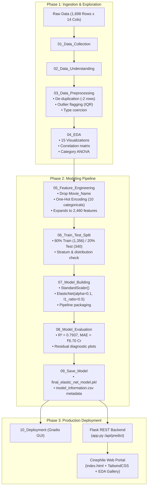
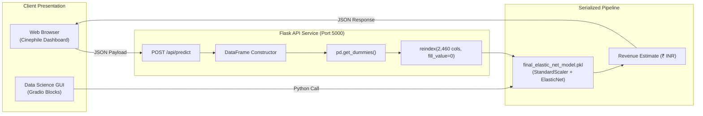

# 🎬 Cinephile — Box Office Revenue Prediction Engine

[](https://www.python.org/)
[](https://scikit-learn.org/)
[](https://flask.palletsprojects.com/)
[](https://tailwindcss.com/)
[](#academic-credits)

An end-to-end Machine Learning pipeline and analytical web platform designed to forecast theatrical box-office revenue ($INR$) for feature films prior to their release. Built on an empirical dataset of **1,696 Indian & global theatrical releases**, the system engineers **2,460 distinct features** and trains a regularized **Elastic Net Regression** pipeline, achieving an **$R^2$ score of 0.7937** and a Mean Absolute Error of **₹6.70 Crore** on unseen test data.

The project features a **10-stage CRISP-DM methodology**, interactive Jupyter research notebooks, a serialised inference pipeline, a **Flask REST API**, and a modern web dashboard dubbed **Cinephile** with an embedded Exploratory Data Analysis (EDA) report gallery.

---

## 📑 Table of Contents

1. [Executive Summary & Problem Statement](#-executive-summary--problem-statement)
2. [End-to-End Architecture & Workflow](#-end-to-end-architecture--workflow)
3. [Dataset Architecture & Feature Schema](#-dataset-architecture--feature-schema)
4. [Exploratory Data Analysis & Empirical Findings](#-exploratory-data-analysis--empirical-findings)
5. [Feature Engineering & Preprocessing](#-feature-engineering--preprocessing)
6. [Machine Learning Algorithm: Why Elastic Net?](#-machine-learning-algorithm-why-elastic-net)
   - [The High-Dimensional Challenge ($p > n$)](#the-high-dimensional-challenge-p--n)
   - [Algorithm Comparison (OLS vs Ridge vs Lasso vs Elastic Net)](#algorithm-comparison)
   - [Mathematical Formulation](#mathematical-formulation)
   - [Feature Selection & Regularization Dynamics](#feature-selection--regularization-dynamics)
7. [Model Evaluation & Diagnostic Analysis](#-model-evaluation--diagnostic-analysis)
   - [Benchmark Performance Metrics](#benchmark-performance-metrics)
   - [Residual & Error Analysis](#residual--error-analysis)
8. [Deployment & Application Stack](#-deployment--application-stack)
   - [Flask REST API Endpoint](#flask-rest-api-endpoint)
   - [Interactive Web Application (Cinephile)](#interactive-web-application-cinephile)
   - [Gradio Prototyping Interface](#gradio-prototyping-interface)
9. [Project Directory Structure](#-project-directory-structure)
10. [Installation & Execution Guide](#-installation--execution-guide)
11. [Academic Credits & Context](#-academic-credits--context)
12. [Future Enhancements](#-future-enhancements)

---

## 🎯 Executive Summary & Problem Statement

### The Problem
The entertainment industry operates in an environment of extreme financial exposure. Film studios, producers, and distribution syndicates commit massive capital—frequently between ₹10 Crore and ₹500+ Crore—towards production budgets, talent fees, and multi-thousand screen distribution contracts months before a film ever meets an audience.

Yet, theatrical gross revenues follow extreme power-law dynamics:
- The dataset records box office returns ranging from **₹3.25 Lakh** for niche independent films to **₹210 Crore+** for nationwide blockbusters.
- Revenue distribution is severely right-skewed: the **mean gross collection is ₹15.02 Crore**, while the **median is only ₹5.50 Crore**.
- Misjudging theatrical demand leads to multi-crore distributor losses, suboptimal screen allocations, and poorly timed release calendar clashes.

### The Objective
To design, train, evaluate, and deploy an interpretable machine learning system that:
1. **Forecasts Pre-Release Revenue**: Accurately estimates `Revenue(INR)` strictly from pre-theatrical signals (budget, planned screen count, genre, release window, intellectual property status, and cast/crew identities).
2. **Quantifies Value Drivers**: Explains the marginal financial impact of screen distribution reach, production investment, franchise branding, holiday timing, and individual star power.
3. **Delivers Real-Time Predictions**: Exposes the trained pipeline through a production-ready REST API and an intuitive visual portal that movie producers, trade analysts, and theater chain operators can query without coding.

---

## 🏗️ End-to-End Architecture & Workflow

The project adheres to the standard **CRISP-DM (Cross-Industry Standard Process for Data Mining)** framework across 10 modularized stages:



---

## 📊 Dataset Architecture & Feature Schema

The dataset represents an empirical collection of **1,696 feature films** (after deduplication) spanning Indian cinema (Bollywood, Tollywood, pan-India releases) and global distributions.

### Feature Specification Table

| Attribute Name | Data Type | Nature | Cardinality / Range | Role & Functional Description |
| :--- | :--- | :--- | :--- | :--- |
| `Movie_Name` | String | Identifier | 1,696 unique | Theatrical title. Dropped prior to modeling to avoid memorization. |
| `Release_Period` | Categorical | Binary | 2 (`Normal`, `Holiday`) | Calendar release window. Captures festive theatrical surges (Diwali, Sankranti, Eid). |
| `Whether_Remake` | Categorical | Binary | 2 (`No`, `Yes`) | Indicates if the screenplay is adapted from a prior release. |
| `Whether_Franchise` | Categorical | Binary | 2 (`No`, `Yes`) | Indicates intellectual property provenance (sequels, cinematic universes). |
| `Genre` | Categorical | Nominal | 14 distinct genres | Primary narrative category (Drama, Comedy, Action, Thriller, Romance, Masala, etc.). |
| `New_Actor` | Categorical | Binary | 2 (`No`, `Yes`) | Flag indicating if the leading cast member is a debutant. |
| `New_Director` | Categorical | Binary | 2 (`No`, `Yes`) | Flag indicating a debut directorial outing (815 debut vs 881 experienced). |
| `New_Music_Director`| Categorical | Binary | 2 (`No`, `Yes`) | Flag indicating a debut composer (554 debut vs 1,142 experienced). |
| `Lead_Star` | Categorical | High-cardinality | 764 unique actors | Identity of primary billing actor; captures marquee box office pull. |
| `Director` | Categorical | High-cardinality | 1,048 unique | Identity of director; captures execution pedigree and brand appeal. |
| `Music_Director` | Categorical | High-cardinality | 630 unique | Identity of music composer; soundtrack popularity heavily affects opening collections in Indian cinema. |
| `Number_of_Screens` | Integer | Continuous | 1 – 4,600 screens | Total domestic theatrical screen saturation count on opening weekend. |
| `Budget(INR)` | Float / Int | Continuous | ₹7,250 – ₹801.61 Cr | Total declared production and negative cost in Indian Rupees. |
| `Revenue(INR)` | Float / Int | Continuous | ₹3.25 Lakh – ₹210 Cr | **Target Variable ($y$)**: Total lifetime theatrical domestic gross in Indian Rupees. |

### Dataset Statistical Profile (Numerical Features)

| Metric | Number of Screens | Budget (INR) | Revenue (INR) [Target] |
| :--- | :---: | :---: | :---: |
| **Count** | 1,696 | 1,696 | 1,696 |
| **Mean** | 553.8 screens | ₹23.77 Crore | ₹15.02 Crore |
| **Standard Deviation**| 782.9 screens | ₹61.34 Crore | ₹24.35 Crore |
| **Minimum** | 1 screen | ₹7,250 | ₹3.25 Lakh |
| **25th Percentile ($Q_1$)**| 30 screens | ₹11.50 Lakh | ₹1.50 Crore |
| **50th Percentile (Median)**| 200 screens | ₹1.24 Crore | ₹5.50 Crore |
| **75th Percentile ($Q_3$)**| 800 screens | ₹17.78 Crore | ₹19.00 Crore |
| **Maximum** | 4,600 screens | ₹801.61 Crore | ₹210.00 Crore |

---

## 🔍 Exploratory Data Analysis & Empirical Findings

Comprehensive visual and statistical analysis was performed across 15 publication-grade figures (`src/output/plots/`), uncovering fundamental industry mechanics:

```
┌────────────────────────────────────────────────────────────────────────┐
│                        PEARSON CORRELATION MATRIX                      │
│                                                                        │
│                      Screens      Budget       Revenue                 │
│   Number_of_Screens  [ 1.00 ]     [ 0.78 ]     [ 0.90 ]  ◄ Highest     │
│   Budget(INR)        [ 0.78 ]     [ 1.00 ]     [ 0.84 ]                │
│   Revenue(INR)       [ 0.90 ]     [ 0.84 ]     [ 1.00 ]                │
└────────────────────────────────────────────────────────────────────────┘
```

### 1. Screen Saturation is the Dominant Revenue Predictor ($r = 0.90$)
Exhibitor confidence—manifested through total opening screen count—is the single strongest determinant of lifetime box office gross. Theater capacity establishes the mathematical ceiling for opening weekend collections. A film releasing across 3,500+ screens will consistently out-gross a 200-screen release regardless of script critical reception.

### 2. The Franchise Multiplier (+202% Revenue Lift)
- Standalone original films averaged **₹13.67 Crore**.
- Franchise installments and sequels averaged **₹41.39 Crore**.
- Recognized intellectual property provides built-in audience awareness, de-risking high production budgets and generating superior pre-sales.

### 3. Holiday Release Calendar Premium (+62.8% Revenue Boost)
- Regular release period films averaged **₹12.16 Crore** ($n = 1,063$).
- Holiday and festival weekend releases averaged **₹19.80 Crore** ($n = 633$).
- Festive windows (Sankranti, Eid, Diwali, Christmas) expand total theatrical footfalls and enable multi-week sustained runs.

### 4. Genre Commercial Hierarchy
- **Volume Leaders**: Drama (639 movies, 37.7%) and Comedy (284 movies, 16.7%) constitute the bulk of domestic theatrical production.
- **Revenue Leaders**: Commercial Masala (average gross **₹100.25 Crore**) and Action (average gross **₹34.60 Crore**) drive industry-defining peak collections.

### 5. Multicollinearity Between Predictors ($r = 0.78$)
Budget and Screen Count exhibit a strong linear correlation ($r = 0.78$), demonstrating that high-budget tentpoles automatically secure wide exhibition circuits. This substantial collinearity strictly precluded the use of unregularized Ordinary Least Squares (OLS) regression.

---

## ⚙️ Feature Engineering & Preprocessing

The preprocessing and feature encoding pipeline systematically transforms messy real-world data into a standardized mathematical tensor ready for regularized regression:

### 1. Data Cleaning (`03_Data_Preprocessing.ipynb`)
- **De-duplication**: Identified and purged 2 duplicate records, stabilizing the dataset to 1,696 pristine observations.
- **Numeric Verification**: Applied `pd.to_numeric(errors='coerce')` across `Number_of_Screens`, `Budget(INR)`, and `Revenue(INR)`. Verified zero negative entries.
- **Defensive Imputation**: Categorical columns imputed with `mode()`; numerical attributes imputed with `median()`.
- **Interquartile Range (IQR) Outlier Auditing**:
  $$\text{IQR} = Q_3 - Q_1, \quad \text{Bounds} = [Q_1 - 1.5 \cdot \text{IQR}, \; Q_3 + 1.5 \cdot \text{IQR}]$$
  While 142 revenue outliers and 265 budget outliers were detected, they were purposefully retained in the training data: in commercial cinema, mega-blockbusters are legitimate market phenomena, not data entry errors.

### 2. High-Dimensional One-Hot Encoding (`05_Feature_Engineering.ipynb`)
- `Movie_Name` was dropped as a non-generalizable unique identifier.
- The 10 categorical attributes—spanning high-cardinality fields such as `Lead_Star` (764 levels), `Director` (1,048 levels), and `Music_Director` (630 levels)—were converted using full dummy encoding with first-category dropping (`drop_first=True`):
  ```python
  X_encoded = pd.get_dummies(X, columns=categorical_columns, drop_first=True)
  ```
- **Dimensionality Expansion**: The input space expanded from 12 raw columns to **2,460 engineered feature columns** (2 numeric + 2,458 binary indicators).

### 3. Holdout Partitioning (`06_Train_Test_Split.ipynb`)
The encoded matrix was partitioned into an 80/20 train-test split with fixed random seed ($42$):
- **Training Set**: 1,356 films $\times$ 2,460 features (Target mean: ₹15.06 Cr, median: ₹5.50 Cr)
- **Testing Set**: 340 unseen films $\times$ 2,460 features (Target mean: ₹14.81 Cr, median: ₹4.63 Cr)

Both partitions maintain statistically indistinguishable revenue distributions, ensuring valid out-of-sample generalization metrics.

---

## 🧠 Machine Learning Algorithm: Why Elastic Net?

The selection of **Elastic Net Regression** was driven by rigorous mathematical considerations intrinsic to this high-dimensional dataset.

### The High-Dimensional Challenge ($p > n$)
In our engineered feature matrix:
- Number of features: $p = 2,460$
- Number of training samples: $n = 1,356$
- **Condition**: $p > n$

In any regime where feature count exceeds observation count, standard **Ordinary Least Squares (OLS)** cannot function:
$$\hat{\beta}_{\text{OLS}} = (X^T X)^{-1} X^T y$$
The Grammian matrix $(X^T X)$ has dimension $2,460 \times 2,460$ but has a maximum rank of at most $1,356$. Consequently, $(X^T X)$ is **strictly singular (non-invertible)**. Ordinary regression yields infinite possible solutions, extreme coefficient inflation, and massive overfitting.

---

### Algorithm Comparison

| Regression Algorithm | Penalty Term | Behavior with $p > n$ | Collinear Feature Handling | Sparsity / Feature Selection | Suitability for This Project |
| :--- | :---: | :---: | :---: | :---: | :---: |
| **Ordinary Least Squares (OLS)** | None | Fails completely (singular matrix) | Unstable; coefficients explode | No selection (all $p$ kept) | ❌ Infeasible |
| **Ridge Regression ($L_2$)** | $\lambda \sum \beta_j^2$ | Invertible & stable: $(X^T X + \lambda I)^{-1}$ | Shrinks correlated features together | No (coefficients $\to 0$, but never 0) | ⚠️ Retains all 2,460 noise features |
| **Lasso Regression ($L_1$)** | $\lambda \sum \|\beta_j\|$ | Can select at most $n$ features ($1,356$) | Arbitrarily selects 1 and drops others | Yes (exact zero coefficients) | ⚠️ Drops correlated talent combinations |
| **Elastic Net Regression** | $\alpha \left( \rho \|\beta\|_1 + \frac{1-\rho}{2} \|\beta\|_2^2 \right)$ | Fully stable & invertible | **Grouping Effect**: keeps correlated predictors together | **Selective Sparsity**: eliminates irrelevant dummy columns | ✅ **Optimal Solution** |

---

### Mathematical Formulation

Elastic Net solves the convex optimization problem:

$$\min_{w} \left\{ \frac{1}{2n} \|y - Xw\|_2^2 + \alpha \rho \|w\|_1 + \frac{\alpha(1-\rho)}{2} \|w\|_2^2 \right\}$$

Where:
- $\frac{1}{2n} \|y - Xw\|_2^2$ is the Mean Squared Error loss.
- $\|w\|_1 = \sum_{j=1}^{p} |w_j|$ is the **$L_1$ penalty (Lasso)**, driving insignificant feature weights to exact zero for automatic feature selection.
- $\|w\|_2^2 = \sum_{j=1}^{p} w_j^2$ is the **$L_2$ penalty (Ridge)**, stabilizing the matrix inversion and encouraging correlated groups of features to share coefficient weights.
- $\alpha = 0.1$ controls the overall regularization magnitude.
- $\rho = \text{l1\_ratio} = 0.5$ balances the penalty equally ($50\%$ Lasso, $50\%$ Ridge).

### Pipeline Standardisation
Because regularisation penalties apply directly to coefficient magnitudes ($|w_j|$ and $w_j^2$), unscaled features would introduce extreme bias: `Budget(INR)` (ranging in hundreds of millions) would be penalized radically differently than binary dummy features ($0$ or $1$). 

We encapsulated preprocessing inside a unified `scikit-learn` `Pipeline`:
```python
from sklearn.pipeline import Pipeline
from sklearn.preprocessing import StandardScaler
from sklearn.linear_model import ElasticNet

model = Pipeline([
    ("scaler", StandardScaler()),
    ("elastic_net", ElasticNet(
        alpha=0.1,
        l1_ratio=0.5,
        max_iter=10000,
        random_state=42
    ))
])
```
`StandardScaler` standardizes each feature $x_j$ to zero mean ($\mu = 0$) and unit variance ($\sigma = 1$), ensuring all 2,460 predictors compete on an identical mathematical footing.

### Feature Selection & Regularization Dynamics
Out of the 2,460 engineered input features:
- **356 coefficients were driven to exact zero ($0.0$)** by the $L_1$ penalty term, effectively pruning non-informative dummy levels.
- **2,104 non-zero coefficients were preserved**, with the $L_2$ penalty preventing multicollinear coefficient explosion among co-occurring directors, actors, and composers.
- Primary macro drivers (`Number_of_Screens`, `Budget(INR)`) and tier-1 lead actors (e.g., Shah Rukh Khan, Prabhas, Salman Khan, Hrithik Roshan) emerged with the highest positive standardized weights.

---

## 📈 Model Evaluation & Diagnostic Analysis

The fitted Elastic Net model was evaluated against the unseen holdout test set containing **340 films**.

### Benchmark Performance Metrics

| Evaluation Metric | Formula | Value (Raw Scale) | Value (Human-Readable) | Theoretical Interpretation |
| :--- | :---: | :---: | :---: | :--- |
| **Coefficient of Determination ($R^2$)** | $1 - \frac{\sum (y_i - \hat{y}_i)^2}{\sum (y_i - \bar{y})^2}$ | **`0.793699`** | **~79.37%** | Explains nearly four-fifths of total theatrical revenue variance using purely pre-release metadata. |
| **Mean Absolute Error (MAE)** | $\frac{1}{n}\sum \|y_i - \hat{y}_i\|$ | **`66,956,283.08`** | **₹6.70 Crore** | The average expected absolute deviation between predicted and actual theatrical collection. |
| **Mean Squared Error (MSE)** | $\frac{1}{n}\sum (y_i - \hat{y}_i)^2$ | **`1.2780 \times 10^{16}`** | — | Quadratic penalty reflecting variance of error terms. |
| **Root Mean Squared Error (RMSE)**| $\sqrt{\text{MSE}}$ | **`113,050,301.63`** | **₹11.31 Crore** | Emphasizes larger errors. The ratio $\text{RMSE} / \text{MAE} \approx 1.69$ highlights outlier blockbuster influence. |

---

### Residual & Error Analysis

Inspection of model residuals ($e_i = y_i - \hat{y}_i$) on the holdout test set reveals critical insights:

```
┌────────────────────────────────────────────────────────────────────────┐
│                        RESIDUAL STATISTICAL SUMMARY                    │
│                                                                        │
│   • Mean Residual:            +₹0.16 Crore   (Virtually Zero Bias)     │
│   • Residual Std. Deviation:   ₹11.32 Crore                            │
│   • Median Residual:          -₹1.22 Crore                             │
│   • Max Under-Prediction:     +₹68.41 Crore  (Historic Blockbusters)   │
│   • Max Over-Prediction:      -₹25.03 Crore  (High-Budget Misfires)    │
└────────────────────────────────────────────────────────────────────────┘
```

#### Key Diagnostic Takeaways:
1. **Tight Mid-Market Convergence**: Films in the standard ₹2 Crore to ₹40 Crore revenue bracket cluster tightly along the $45^\circ$ perfect-prediction diagonal.
2. **Regression Toward the Mean on Extreme Outliers**: Like all regularized linear models, Elastic Net exhibits slight conservatism on extreme right-tail blockbusters (e.g., predicting ₹111.6 Crore for an ₹180 Crore record-breaker).
3. **Non-Negative Post-Processing**: For a negligible fraction of ultra-low-budget niche films where linear extrapolation produced a negative number, the deployed inference service clips the result to `₹0.00`.

---

## 🚀 Deployment & Application Stack

The project provides three complementary deployment interfaces:



### Flask REST API Endpoint

Located at [`src/backend/app.py`](file:///d:/ML/Project/src/backend/app.py), the backend exposes a robust, CORS-enabled HTTP endpoint.

#### `POST /api/predict`
Accepts raw categorical and continuous film descriptors, dynamically performs dummy alignment against the 2,460 training features, and executes inference:

**Request Payload (`application/json`):**
```json
{
  "releasePeriod": "Holiday",
  "whetherRemake": "No",
  "whetherFranchise": "Yes",
  "genre": "Action",
  "newActor": "No",
  "newDirector": "No",
  "newMusicDirector": "No",
  "leadStar": "Shah Rukh Khan",
  "director": "Atlee",
  "musicDirector": "Anirudh Ravichander",
  "numberOfScreens": 4500,
  "budget": 3000000000
}
```

**Success Response (`200 OK`):**
```json
{
  "success": true,
  "predictedRevenue": 1482930210.45
}
```

---

### Interactive Web Application (Cinephile)

The web dashboard located in [`src/website/index.html`](file:///d:/ML/Project/src/website/index.html) delivers an enterprise-grade experience:
- **Tailwind CSS & Lucide Icons**: Modern dark-mode cinema aesthetic with typography inspired by JetBrains Mono and Hanken Grotesk.
- **Ambient Poster Wall**: 18 dynamically styled Telugu & Indian cinema posters creating a cinematic backdrop.
- **Real-Time Prediction Calculator**: Dropdowns populated with verified industry talent and parameter sliders, communicating directly with the Flask API (with local fallback heuristics if backend is offline).
- **Embedded EDA Report Gallery**: 14 zoomable, publication-quality plots categorized by *Distributions*, *Correlations*, *Genre Drivers*, and *Model Diagnostics* with an interactive modal lightbox.

---

### Gradio Prototyping Interface

Implemented in [`src/Notebooks/10_Deployment.ipynb`](file:///d:/ML/Project/src/Notebooks/10_Deployment.ipynb), `gr.Blocks()` provides a lightweight, interactive local GUI for rapid testing by analysts directly within a Jupyter session.

---

## 📁 Project Directory Structure

```
d:\ML\Project
├── Dataset/
│   ├── raw/
│   │   └── Data_for_repository.csv           # 1,698 raw film records (14 attributes)
│   └── processed/
│       ├── cleaned_movie_data.csv            # 1,696 deduplicated & cleaned records
│       ├── final_dataset.csv                 # 2,460 one-hot encoded feature matrix
│       ├── train_data.csv                    # 80% holdout training partition (1,356 rows)
│       ├── test_data.csv                     # 20% holdout testing partition (340 rows)
│       ├── model_evaluation.csv              # Benchmark metrics (MAE, MSE, RMSE, R²)
│       ├── model_information.csv             # Model metadata & hyperparameters
│       └── model_predictions.csv             # Test-set ground truth vs predicted values
├── Documentation/
│   ├── Bollywood Box Office Revenue Prediction.pptx   # Executive presentation slide deck
│   ├── Box_Office_Revenue_Prediction.pptx             # Comprehensive 19-slide technical deck
│   ├── Project abstract submission Template.docx      # Academic submission document
│   └── Project abstract submission Template.pdf       # Signed academic project abstract
├── src/
│   ├── backend/
│   │   ├── app.py                            # Production Flask REST API (/api/predict)
│   │   └── requirements.txt                  # Python dependencies for inference server
│   ├── models/
│   │   ├── elastic_net_model.pkl             # Serialized Elastic Net pipeline
│   │   └── final_elastic_net_model.pkl       # Production frozen model pipeline
│   ├── Notebooks/
│   │   ├── 01_Data_Collection.ipynb          # Raw data ingestion & integrity verification
│   │   ├── 02_Data_Understanding.ipynb       # Target variable distribution & summary statistics
│   │   ├── 03_Data_Preprocessing.ipynb       # Deduplication, type conversion & IQR outlier checks
│   │   ├── 04_EDA.ipynb                      # 15 Seaborn & Matplotlib analytical figures
│   │   ├── 05_Feature_Engineering.ipynb      # High-cardinality one-hot dummy expansion (2,460 cols)
│   │   ├── 06_Train_Test_Split.ipynb         # 80/20 holdout partitioning (random_state=42)
│   │   ├── 07_Model_Building.ipynb           # StandardScaler + ElasticNet pipeline training
│   │   ├── 08_Model_Evaluation.ipynb         # Metric computation & residual diagnostic curves
│   │   ├── 09_Save_Model.ipynb               # Artifact serialization & consistency testing
│   │   └── 10_Deployment.ipynb               # Interactive Gradio local web interface
│   ├── output/
│   │   └── plots/                            # High-resolution generated analytical figures (1-15)
│   └── website/
│       ├── index.html                        # Cinephile web portal & EDA dashboard
│       ├── plots/                            # Visual assets for interactive web gallery
│       └── posters/                          # Theatrical poster assets for ambient wallpaper
└── README.md                                 # Comprehensive project documentation
```

---

## 🛠️ Installation & Execution Guide

### 1. Prerequisites
- **Python**: Version 3.10 or higher
- **Web Browser**: Chrome, Firefox, or Edge

### 2. Environment Setup & Dependency Installation
Clone or navigate to the repository directory and configure a virtual environment:

```powershell
# Navigate to the project root
cd d:\ML\Project

# Create virtual environment (optional but recommended)
python -m venv .venv
.\.venv\Scripts\Activate.ps1

# Install required dependencies
pip install -r src\backend\requirements.txt
pip install jupyterlab matplotlib seaborn gradio
```

### 3. Running the Jupyter Notebooks
To reproduce data processing and model training step-by-step:
```powershell
jupyter lab src/Notebooks/
```
Execute notebooks sequentially from `01_Data_Collection.ipynb` to `10_Deployment.ipynb`.

### 4. Running the Flask REST API Backend
Launch the API server to enable live machine learning inferences:
```powershell
python src/backend/app.py
```
*The service will initialize at `http://127.0.0.1:5000` with the route `/api/predict`.*

### 5. Launching the Cinephile Web Dashboard
With the Flask API running in the background, open the web portal:
- Simply double-click [`src/website/index.html`](file:///d:/ML/Project/src/website/index.html) in Windows Explorer, or
- Serve it via Python's built-in HTTP server:
```powershell
cd src\website
python -m http.server 8080
```
Open your browser at `http://127.0.0.1:8080` to interact with the full predictor and EDA report.

---

## 🎓 Academic Credits & Context

- **Institution**: Koneru Lakshmaiah Education Foundation (KL University / KLH), Off-Campus Hyderabad
- **Course**: Machine Learning (`25SC2107E`)
- **Academic Term**: Y25 — 2026-2027 Trimester - 4
- **Project Title**: *Box-Office Revenue Prediction Using Elastic Net Regression*
- **Project Section & Team**: Section No. 9, Team No. 14
- **Team Members**:
  - **Yeshwanth** (Roll Number: `2520030525`)
  - **Ritvik** (Roll Number: `2520030283`)

---

## 🔮 Future Enhancements

1. **Target Log Transformation ($\log(1 + y)$)**:
   Applying a logarithmic transformation to `Revenue(INR)` before regression will normalize the right-tail skewness and minimize under-prediction of mega-budget blockbusters.
2. **Non-Linear Tree Ensembles**:
   Evaluating Gradient Boosted Decision Trees (XGBoost, LightGBM, CatBoost) to capture non-linear interaction terms between director reputations and lead-actor pairings.
3. **Frequency & Target Encoding**:
   Grouping ultra-rare director/actor levels with $< 2$ releases into an `"Other"` token or applying Leave-One-Out Target Encoding to reduce the feature space from 2,460 columns down to $< 50$ columns.
4. **Digital Sentiment & Engagement Signals**:
   Incorporating pre-release YouTube trailer view counts, like ratios, and social media trend velocities as dynamic real-time features.
